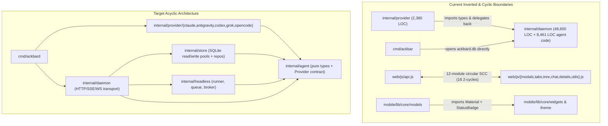

# Full-Repository Architecture Audit (2026-11-10)

This directory documents the comprehensive architecture audit completed on 2026-11-10. It establishes baseline metrics, identifies critical defects, diagnoses circular dependencies, and defines remediation waves across the Go daemon, Web dashboard, Mobile companion, and CI pipelines.

## Audit Baseline Metrics

The audit analyzed 204 source files across Go, JavaScript, and Flutter/Dart codebases:
* **Total source files:** 204
* **Files > 300 non-blank/non-comment lines:** 87 (`warn` threshold)
* **Files > 500 non-blank/non-comment lines:** 56 (`ERROR` threshold)
* **Target architecture contract:** Zero package cycles, unidirectional layering, and maximum file size under 500 lines.

## Audit Subsystem Index

| Document | Subsystem Scope | Primary Hotspots Analyzed |
| :--- | :--- | :--- |
| [01-go-backend-and-cli.md](01-go-backend-and-cli.md) | Daemon, CLI, Relay, SQLite | `server.go`, `db.go`, `headless.go`, `server_sessions.go`, `status_inspector.go`, `transcript.go`, `tools.go`, `cmd/ackbar` |
| [02-web-and-ci.md](02-web-and-ci.md) | Web GUI, ES Modules, CI/CD | `chat.js`, `tasks.js`, `modals.js`, `tabs.js`, `utils.js`, `api.js`, 12-module cyclic SCC, `.github/workflows/ci.yml` |
| [03-mobile-and-parity.md](03-mobile-and-parity.md) | Flutter Companion, Cross-Client Parity | `fleet_providers.dart`, `attention_screen.dart`, 3-way client logic drift, analyzer gates |

## Current vs Target Subsystem Architecture

## Cross-Stack Critical Defect Index

| Priority | Subsystem | Vulnerability / Defect | Reference |
| :--- | :--- | :--- | :--- |
| **P0** | Daemon Bind & WS | Default `0.0.0.0` bind, wildcard CORS, disabled WS Origin check, unknown tmux spawn | [01-go-backend-and-cli.md](01-go-backend-and-cli.md#3-security-sqlite--reliability-defects) |
| **P0** | Remote Execution | Remote SSH commands use Go `%q` formatting and omit `--` before targets | [01-go-backend-and-cli.md](01-go-backend-and-cli.md#3-security-sqlite--reliability-defects) |
| **P0** | Auth Middleware | Allowlist omits `/js/*` (assets return 401); `ackbar-hook` omits `ACKBAR_TOKEN` | [01-go-backend-and-cli.md](01-go-backend-and-cli.md#3-security-sqlite--reliability-defects) |
| **P0** | Web Security | Stored/DOM XSS via unescaped session/host fields; regex Markdown sanitizer bypass | [02-web-and-ci.md](02-web-and-ci.md#3-security--frontend-risks) |
| **P1** | File Exposure | `/v1/files/content` allows reading sensitive `$HOME` credentials and databases | [01-go-backend-and-cli.md](01-go-backend-and-cli.md#3-security-sqlite--reliability-defects) |
| **P1** | Relay Transport | `httptest.NewRecorder` in relay client drops WebSocket PTY hijacking | [01-go-backend-and-cli.md](01-go-backend-and-cli.md#3-security-sqlite--reliability-defects) |
| **P1** | SQLite Engine | Missing `SetMaxOpenConns`; `DEFERRED` lock upgrades trigger `SQLITE_BUSY`; slow queries | [01-go-backend-and-cli.md](01-go-backend-and-cli.md#3-security-sqlite--reliability-defects) |
| **P1** | Agent Transcripts | `ExtractTranscript` ignores Codex, Grok, and OpenCode transcripts | [01-go-backend-and-cli.md](01-go-backend-and-cli.md#2-boundary-inversion--provider-drift) |
| **P1** | Mobile Network | Attention mic hardcodes mock; shared input controller & action bug | [03-mobile-and-parity.md](03-mobile-and-parity.md#2-mobile-hotspots--defects) |
| **P1** | Fleet Purge | `handlePurge` invokes unauthenticated peer fan-out with no hop guard | [01-go-backend-and-cli.md](01-go-backend-and-cli.md#3-security-sqlite--reliability-defects) |

## Prioritized Remediation Roadmap

See [completed remediations in the tasks archive](../archive/completed-tasks.md#2-architecture-audit-remediations-2026-11) for completed audit tasks. Remediation follows three sequential waves to isolate behavioral bug fixes from behavior-neutral refactoring.

### Wave 1: P0 Security & Correctness Fixes (Bug PRs)
* Bind `ackbard` strictly to `127.0.0.1` by default; enforce WebSocket `Origin` checks and origin-matched CORS.
* Replace `%q` SSH command formatting with single-quoted arguments and prepend `--` before SSH targets.
* Add `/js/*` to `authMiddleware` allowlist; inject `ACKBAR_TOKEN` in `cmd/ackbar-hook`.
* Replace `innerHTML` interpolations with `escapeHtml` / `textContent` in Web UI (`palette.js`, `tabs.js`, `modals.js`).
* Replace blacklist Markdown sanitizer in `web/js/utils.js` with strict allowlist sanitizer; pin `marked` CDN with SRI.
* Fix AttentionScreen controller sharing, mock mic stub, and action routing.
* Register Codex, Grok, and OpenCode transcript parsers in `internal/daemon/transcript.go`.

### Wave 2: Architecture Contract & Baseline CI Gates (Setup Mode)
* Rewrite [docs/architecture.md](../architecture.md) defining strict module boundaries, dependency hierarchy, and size limits.
* Add static gates to T0 and `.github/workflows/ci.yml`: `go vet ./...`, `AGENTS.md <= 160`, `chat.test.mjs`.
* Integrate `hotspots.py --check` with explicit file exemptions listed in `docs/architecture.md`.
* Restore suppressed rules in `mobile/analysis_options.yaml` (`unused_element`, `use_build_context_synchronously`).

### Wave 3: Behavior-Neutral Hotspot Refactors (Ordered by Churn × Risk)
1. Extract `internal/agent` package to invert `internal/daemon` -> `internal/provider` dependency and unify parsers.
2. Decompose `internal/daemon/server.go` (`949` lines code, `110` churn) into middleware, SSE broker, and scheduler.
3. Split `internal/daemon/db.go` (`3,510` lines code, `32` churn) into typed repository files with `BEGIN IMMEDIATE` pools.
4. Split `web/js/chat.js` (`5,197` lines code, `23` churn) into 9 focused ES modules under `web/js/chat/`.
5. Break 12-module Web circular import SCC via unidirectional state event bus.
6. Decompose `internal/daemon/headless.go` (`1,819` lines) and `internal/daemon/server_sessions.go` (`1,848` lines).
7. Decompose Flutter `fleet_providers.dart` (`1,145` lines) and `attention_screen.dart` (`980` lines).
