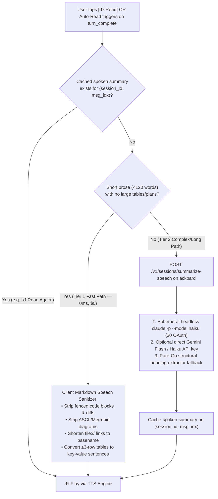

# Voice-Driven Supervisor Control Layer & Audio Companion

This document specifies the architecture, user scenarios, conversational protocol, and implementation roadmap for Project Ackbar's **Voice & Supervisor Control Layer**—enabling hands-free and semi-free supervision of AI coding sessions across local and remote machines.

---

## 1. Vision & Core Scenarios

While Ackbar's Web Dashboard and Mobile App provide visual control over coding sessions, developers frequently operate in contexts where looking at or typing on a screen is impractical or undesirable.

The Supervisor Control Layer enables four distinct interaction modes by **decoupling input modality (Voice vs. Text/Tap) from output modality (Spoken Audio vs. Visual Markdown)**:

| Scenario | Physical Context | Input Modality | Output Modality | Key Capabilities Needed |
| :--- | :--- | :--- | :--- | :--- |
| **🚗 Driving / On the Road** | 100% eyes-free & hands-free | **🎤 Voice In** *(Continuous / AirPods trigger)* | **🔊 Audio Out** *(`Auto-Read: ON`)* | Listen to fleet status, hear blocker questions, speak answers, spawn new sessions, and explore plan outlines by voice. |
| **🚌 Bus / Train Commute** | Public transit; can look at phone & type, but **do not want to speak out loud** | **⌨️ Text / 1-Tap Chips In** *(Mic `OFF`)* | **🔊 Headphones Audio Out** *(`Auto-Read: ON`)* | Silently type questions or tap quick-reply chips (`[Summarize Plan]`, `[Approve]`) and have concise responses read aloud into headphones. |
| **🍳 Cooking / At Home** | Hands busy/messy; near phone or Mac speaker with occasional screen glance | **🎤 Voice In** *(Mic `ON` or `/voice`)* | **🔊 Audio Out + 🖥️ Visual** *(`Auto-Read: ON`)* | Ask for progress updates, interactively drill down into large implementation plans section-by-section, and dispatch approvals. |
| **💻 At Desk** | Standard workstation focus | **⌨️ Keyboard** *(Mic `OFF`)* | **🖥️ Visual Only** *(`Auto-Read: OFF` by default)* | Zero automatic speech or extra token overhead; on-demand **`[🔊 Read]`** button on individual long responses when leaning back to listen. |

---

## 2. Architecture Alternatives & Trade-Off Analysis

We evaluated four architectures against the scenarios above:

| Dimension | **Option 1: Ackbar MCP + Commercial App (Claude / ChatGPT)** | **Option 2: Ackbar Supervisor Session + Native Chat TTS/Mic (Recommended)** | **Option 3: Realtime Audio WebSocket (Gemini Live / OpenAI Realtime)** | **Option 4: Messaging Bot Bridge (Telegram / Discord)** |
| :--- | :--- | :--- | :--- | :--- |
| **🚗 Driving (Voice → Audio)** | ⚠️ Good, but live voice modes in 3rd-party apps can occasionally drop custom MCP calls | ✅ **Excellent** (Native STT + `Auto-Read: ON` directly wired to `ackbard`) | ⭐ **Best latency** (<500ms barge-in) | ⚠️ Clunky (Manual voice note recording) |
| **🚌 Bus (Text → Audio)** | ❌ **Poor fit** (Exiting Voice Mode to type disables automatic spoken replies) | ⭐ **Best fit** (Independent **`🎤 Mic: OFF`** + **`🔊 Auto-Read: ON`** toggles + quick chips) | ✅ Good (Supports text-in + audio-out on same socket) | ⚠️ Manual audio file playback |
| **🍳 Cooking (Voice → Audio + Glance)** | ✅ Good | ✅ **Excellent** (Live session cards & diffs visible while conversing) | ⭐ Best conversational feel | ❌ Too much screen tapping |
| **📋 Progressive Plan Drill-Down** | ✅ Supported via MCP instructions | ✅ **Native** (Full plan stays in session transcript; spoken summary gives outline first) | ✅ Supported | ✅ Supported |
| **Monthly Running Cost (\$)** | **\$0 extra** (Uses Claude Pro/Max) | **\$0.00/mo** (Flat-rate Claude Code OAuth + on-device STT/TTS) or **~\$1–\$3/mo** (Cloud TTS/Haiku API) | **~\$10–\$30/mo** (Continuous audio token streaming) | **~\$2–\$5/mo** (LLM + TTS APIs) |
| **Engineering Effort** | **Low** (Extend `internal/mcp` + `/v1/mcp`) | **Low–Medium** (Extend `internal/mcp` + add TTS/Mic & lazy summarizer to existing Chat UI) | **Medium–High** (WebRTC/WebSocket audio streaming pipeline) | **Medium** (External bot daemon) |

### Why Option 2 + Supervisor MCP Wins
1. **Reuses Ackbar's Existing Headless & Tmux Chat Engine:** Ackbar already runs Claude Code, Antigravity, and Codex sessions over flat-rate OAuth (`internal/daemon/headless.go`, `web/js/chat.js`, and `mobile/lib/features/transcript/`).
2. **A Dedicated "⚓ Ackbar Supervisor" Session:** By equipping `ackbar mcp` (`internal/mcp/tools.go`) with session-level control tools, any Claude Code session can act as a fleet-wide **Chief of Staff** at **\$0 extra API cost**.
3. **Works with Claude Code `/voice` on Desktop & Native STT/TTS on Mobile:**
   * Note that Claude Code's built-in `/voice` CLI command only provides **local Speech-to-Text (STT)** (holding `Spacebar` on the local machine) and does **not** include Text-to-Speech (TTS) or work over remote mobile connections.
   * Adding **`🔊 Auto-Read`** and **`🎤 Mic`** controls to Ackbar's Web PWA and Flutter Mobile Chat views bridges both directions across desktop and mobile.

---

## 3. Unified Supervisor & Task MCP Control Layer (`ackbar mcp`)

Currently, `internal/mcp/tools.go` only exposes basic Task Board status tools (`list_tasks`, `update_task`, `report_blocker`, etc.) meant for worker agents inside a worktree. To enable the **⚓ Ackbar Supervisor** session to act as both a hands-free **Session Chief of Staff** and a top-down **Task & Stage Orchestrator**, `ackbar mcp` unifies **Session Control Tools** with **Task & Workstream Stage-Gate Tools**:

### 3.1 Session Control Tools (Direct Session Supervision)

| MCP Tool | Backing `ackbard` Endpoint | Supervisor Use Case |
| :--- | :--- | :--- |
| **`list_sessions`** | `GET /v1/sessions?federated=true` | List active, blocked, or idle sessions across all hosts with current activity, context %, and blocker questions. |
| **`get_session_output`** | `GET /v1/sessions/transcript` | Fetch the latest 1–3 assistant messages, active implementation plan, or current blocker options for a session. |
| **`send_session_input`** | `POST /v1/sessions/respond` / PTY | Answer a blocked question (e.g. `"Option 1"`), approve a plan, or send a follow-up prompt to an idle/working session. |
| **`spawn_session`** | `POST /v1/meta/resolve` + `/v1/sessions/spawn` | Start a new coding session on a target host and project directory with an initial prompt (injected at CLI launch via `$ACKBAR_INIT_PROMPT` for `claude-code` and `antigravity`, with automatic capability routing for `-ios`/`-android` repo paths). |
| **`control_session`** | `POST /v1/sessions/control` & `/handover` | Execute lifecycle actions (`resume`, `restart`, `kill`, `handover`, `done`, `later`). |

### 3.2 Zero-Input Supervisor Dispatcher & Task Orchestration Tools

See [`docs/work-overview/01-data-model-and-lifecycle.md`](work-overview/01-data-model-and-lifecycle.md) and [`docs/work-overview/08-mcp-and-skill-provisioning.md`](work-overview/08-mcp-and-skill-provisioning.md) for the complete data model:

| MCP Tool | Backing `ackbard` Endpoint | Supervisor / Worker Use Case |
| :--- | :--- | :--- |
| **`bind_supervisor_session`** | `POST /v1/sessions/bind-supervisor` | Auto-binds a zero-input `⚓ Supervisor` session to a project (`is_supervisor=1`) and sets its title on the first user message. |
| **`create_task`** | `POST /v1/tasks` | Creates a Product/Design (`kind="design"`) or Code (`kind="code"`) task with optional `agent` runtime and `prompt` instructions, auto-binding unbound supervisors, spawning dedicated `📋 Task` workers (`depends_on` sequential chain supported), and immediately transitioning `auto_start` tasks to `IN_PROGRESS` (`active`). |
| **`attach_deliverable`** | `POST /v1/tasks/deliverable` | Attaches **Claude Published Artifacts** (`url`) or **Google Workspace / Drive** files (`gdrive`, `gdocs`, `gslides`, `gsheets`) + synced `content_md` for cross-host learnings handoff. |

### 3.3 Uniform 3-Way LWW Peer Sync (`macbook` $\leftrightarrow$ `macmini` $\leftrightarrow$ `legion`)
Every session ID in Ackbar is globally namespaced as `<agent>:<host>:<uuid>` (e.g. `claude-code:macmini:8492`, `antigravity:legion:8491`). Multi-host collection and state replication operate across two complementary patterns:
1. **Uniform 3-Way LWW Peer Sync (`macbook` $\leftrightarrow$ `macmini` $\leftrightarrow$ `legion`):** Control-plane tables (`tree_nodes`, `node_host_paths`, session metadata `node_path`/`custom_title`/`is_later`/`is_supervisor`, `tasks`, `task_workstreams`, and `task_deliverables`) replicate across all hosts using `updated_at` Last-Write-Wins + startup/wake delta pull (`GET /v1/sync/state?since=<ts>`). When `macbook` is asleep, `legion` and `macmini` serve the complete session tree to `iphone` with `macbook` sessions badged as `[offline]`.
2. **Daemon Hub Federation (`ackbard` / `ackbar-relay`):** Any `ackbard` node fans out `GET /v1/sessions?federated=true`, `GET /v1/nodes?federated=true`, and `GET /v1/tasks?federated=true`, and proxies `GET /v1/sessions/transcript`, `POST /v1/sessions/spawn`, and `POST /v1/sessions/control` across peer hosts registered in SQLite (`GET /v1/hosts`), gracefully skipping offline/asleep hosts after a 1.5s health timeout.

---

## 4. Progressive Disclosure for Large Plans & Complex Outputs

When a session produces a large `implementation_plan.md`, a multi-row comparison table, or a 150-line response with code snippets, reading the raw text aloud is unusable.

### 4.1 Conversational Drill-Down Protocol
Instead of dumping an entire plan in a single monologue, spoken briefings follow a strict **Outline-First Protocol**:
1. **High-Level Pitch (2–3 sentences):** State that the plan/response is ready and summarize the core architectural idea.
2. **Section Inventory:** Name the major sections or trade-offs and highlight any open questions requiring a decision.
3. **Interactive Prompt:** Ask the user which section they want to hear about first:
   > *"The implementation plan for Rokt attributes is ready. The main idea is adding three tracking events across two files in ngl-ios. It has four detailed sections—Schema Changes, SDK Initialization, Unit Tests, and Rollout—plus one open question about verbose staging logs. Which part would you like to hear about first, or should we jump to the open question?"*
4. **Follow-Up Exploration:** Because the full plan remains in the session transcript, when the user asks *"Tell me about SDK Initialization"* while `Auto-Read` is `ON` (or via `🎤`), the client appends a concise-mode hint (`[Reply concisely in 2–3 spoken sentences]`) so the follow-up answer is immediately speech-friendly.

---

## 5. Audio Playback UX & 2-Tier Lazy Speech Pipeline

### 5.1 Manual Per-Message Controls vs. Automatic Header Toggle
Voice summaries are **never generated eagerly** when sitting at a desk with `Auto-Read: OFF`, avoiding wasted tokens and latency. Speech generation is **100% lazy (on-demand)**:

* **Header Toggle (`[🔊 Auto-Read: ON / OFF]`):**
  * **`OFF` (Default at desk):** Silent. No speech summaries are generated when turns complete.
  * **`ON` (Driving, Bus, Cooking):** Automatically triggers the speech pipeline as soon as an assistant turn finishes (`turn_complete`).
* **Header Toggle (`[🎤 Mic: ON / OFF]`):**
  * Independent of `Auto-Read` so **Bus Commute Mode** can keep `🎤 Mic: OFF` (silent typing / 1-tap quick chips) while keeping `🔊 Auto-Read: ON` in headphones.
* **Per-Message Bubble Buttons (Next to `[📋 Copy]` on every assistant message):**
  * **`[🔊 Read]`:** Ad-hoc trigger on any message bubble (latest or historical) even when `Auto-Read` is `OFF`.
  * **`[⏹️ Stop]`:** Immediately halts active TTS playback (speaking into the mic or sending a new message also barges in and stops playback automatically).
  * **`[↺ Read Again]`:** Replays the cached spoken audio for that message from the beginning without re-running summarization (also triggered hands-free by saying *"Repeat that"* or *"Read that again"*).
  * **`[📖 Read Full]`:** Optional secondary pill when a long message was condensed into a spoken outline, allowing full-text playback on demand.

### 5.2 Handling Code Snippets, Tables, and Long Plans (The 2-Tier Pipeline)

When speech is triggered for a message (via **`[🔊 Read]`** or **`Auto-Read: ON`**), the client and `ackbard` process the Markdown through a two-tier pipeline:



#### Tier 1: Deterministic Client Speech Sanitizer (0ms Latency, No LLM Call)
For the ~80% of turns where the agent writes a few sentences of explanation alongside a code block or file link:
* **Fenced Code Blocks & Diffs (` ```go ... ``` `):** Never read syntax aloud; stripped cleanly so only the surrounding prose explanation is spoken.
* **ASCII / Mermaid Diagrams:** Stripped completely.
* **Small Tables (≤ 3 rows):** Read naturally as `"Column: Value"` pairs.
* **File Links & Paths (`[server.go](file:///Users/.../internal/daemon/server.go#L941)`):** Stripped down to the basename (`"server.go"`).
* **UUIDs & Hashes:** Stripped or shortened.

#### Tier 2: On-Demand Daemon Summarizer (`POST /v1/sessions/summarize-speech`)
When a message contains a **large implementation plan (>150 words)**, **large tables (>3 rows)**, or **multi-file diffs without summary prose**:
1. The client calls `POST /v1/sessions/summarize-speech` on `ackbard` with `{ session_id, message_index, content }`.
2. `ackbard` generates a 2–3 sentence spoken summary + section outline using its fallback chain:
   * **Primary (\$0 Flat-Rate OAuth):** Reuses `resolveClaudeBinary()` and `StripBilledCredentials()` from `internal/daemon/headless.go` to invoke a stateless one-shot `claude -p --model haiku --no-session-persistence` call (~1.5s latency, zero extra API cost).
   * **Optional Fast Cloud API:** Direct HTTP call to Gemini Flash or Claude Haiku if an API key is configured (~400ms latency).
   * **Offline Fallback:** Pure-Go Markdown AST extractor that combines the opening paragraph, `##`/`###` section headings, and the closing question.
3. The resulting `spoken_text` and optional `suggested_chips` (e.g. `["Hear Section 1", "Hear Open Question", "Approve Plan"]`) are cached in memory/SQLite by `(session_id, message_index)` so subsequent **`[↺ Read Again]`** taps are instant.

---

## 6. Implementation Roadmap Archive

All 4 implementation phases are complete. See [docs/archive/completed-tasks.md](archive/completed-tasks.md#4-voice-companion--live-audio-bridge-4-phase-roadmap) for the historical roadmap.
